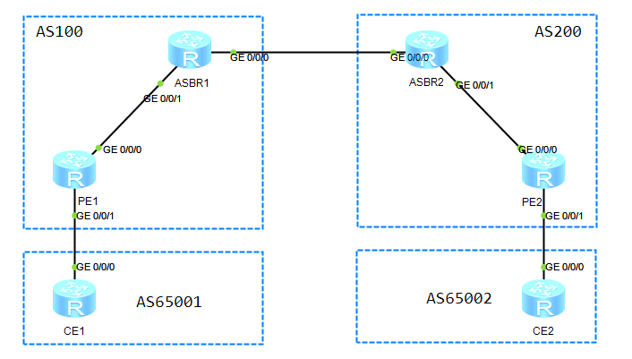

## 跨域VPN-OptionB配置

### 1.组网图




| 设备  | 接口      | IP地址       | 设备  | 接口      | IP地址       |
| ----- | --------- | ------------ | ----- | --------- | ------------ |
| CE1   | GE0/0/0   | 10.1.1.2/24  | CE2   | GE0/0/0   | 10.2.1.2/24  |
| PE1   | GE0/0/0   | 172.1.1.2/24 | PE2   | GE0/0/0   | 162.1.1.2/24 |
|       | GE0/0/1   | 10.1.1.1/24  |       | GE0/0/1   | 10.2.1.2/24  |
|       | loopback0 | 3.3.3.3/32   |       | loopback0 | 4.4.4.4/32   |
| ASBR1 | GE0/0/0   | 192.1.1.1/24 | ASBR2 | GE0/0/0   | 192.1.1.2/24 |
|       | GE0/0/1   | 172.1.1.1/24 |       | GE0/0/1   | 162.1.1.1/24 |
|       | loopback0 | 1.1.1.1/32   |       | loopback0 | 2.2.2.2/32   |

### 2.组网需求

CE1和CE2属于同一个VPN。CE1通过AS100的PE1接入，CE2通过AS200的PE2接入。
采用OptionB方式实现跨域的BGP/MPLS IP VPN：
● ASBR1与ASBR2间通过MP-EBGP交换VPNv4路由；
● ASBR不对接收的VPNv4路由进行VPN-Target过滤。

### 3.配置步骤

```bash

```


## 跨域VPN-OptionC配置

### 1.组网图


| 设备  | 接口      | IP地址       | 设备  | 接口      | IP地址       |
| ----- | --------- | ------------ | ----- | --------- | ------------ |
| CE1   | GE0/0/0   | 10.1.1.2/24  | CE2   | GE0/0/0   | 10.2.1.2/24  |
| PE1   | GE0/0/0   | 172.1.1.2/24 | PE2   | GE0/0/0   | 162.1.1.2/24 |
|       | GE0/0/1   | 10.1.1.1/24  |       | GE0/0/1   | 10.2.1.2/24  |
|       | loopback0 | 3.3.3.3/32   |       | loopback0 | 4.4.4.4/32   |
| ASBR1 | GE0/0/0   | 192.1.1.1/24 | ASBR2 | GE0/0/0   | 192.1.1.2/24 |
|       | GE0/0/1   | 172.1.1.1/24 |       | GE0/0/1   | 162.1.1.1/24 |
|       | loopback0 | 1.1.1.1/32   |       | loopback0 | 2.2.2.2/32   |

### 2.组网需求

- CE1和CE2属于同一个VPN。CE1通过AS100的PE1接入，CE2通过AS200的PE2接入。
- 采用OptionC方式实现跨域的BGP/MPLS IP VPN。

### 3.配置步骤

```bash
(1)配置CE1
#
 sysname CE1
#
interface GigabitEthernet0/0/0
 ip address 10.1.1.2 255.255.255.0 
# //配置CE与PE建立EBGP对等体
bgp 65001
 peer 10.1.1.1 as-number 100 
 #
 ipv4-family unicast
  undo synchronization
  import-route direct
  peer 10.1.1.1 enable
#
return

(2)配置PE1
#
 sysname PE1
# //创建VPN实例
ip vpn-instance vpn1
 ipv4-family
  route-distinguisher 100:1
  vpn-target 100:1 export-extcommunity
  vpn-target 100:1 import-extcommunity
# //配置LSR ID使能MPLS
mpls lsr-id 3.3.3.3
mpls
#
mpls ldp
# //使能接口MPLS
interface GigabitEthernet0/0/0
 ip address 172.1.1.2 255.255.255.0 
 mpls
 mpls ldp
# //绑定VPN实例
interface GigabitEthernet0/0/1
 ip binding vpn-instance vpn1
 ip address 10.1.1.1 255.255.255.0 
#
interface LoopBack0
 ip address 3.3.3.3 255.255.255.255 
#
bgp 100
 peer 1.1.1.1 as-number 100 
 peer 1.1.1.1 connect-interface LoopBack0
 peer 4.4.4.4 as-number 200  //PE1与PE2建立MP-BGP对等体
 peer 4.4.4.4 ebgp-max-hop 10 //PE1到PE2跳数大于实际跳数
 peer 4.4.4.4 connect-interface LoopBack0
 #
 ipv4-family unicast
  undo synchronization
  peer 1.1.1.1 enable
  peer 1.1.1.1 label-route-capability //使能与ASBR1交换标签IPv4路由的能力
  peer 4.4.4.4 enable
 # 
 ipv4-family vpnv4
  policy vpn-target
  peer 4.4.4.4 enable //使能对等体交换VPNv4路由信息的能力
 #
 ipv4-family vpn-instance vpn1 //PE1与CE建立EBGP对等体关系,引入VPN路由
  import-route direct
  peer 10.1.1.2 as-number 65001 
#
ospf 1 
 area 0.0.0.0 
  network 3.3.3.3 0.0.0.0 
  network 172.1.1.0 0.0.0.255 
#
return


（3）配置ASBR1
#
 sysname ASBR1
#
mpls lsr-id 1.1.1.1
mpls
#
mpls ldp
#
interface GigabitEthernet0/0/0
 ip address 192.1.1.1 255.255.255.0 
 mpls
#
interface GigabitEthernet0/0/1
 ip address 172.1.1.1 255.255.255.0 
 mpls
 mpls ldp
#
interface LoopBack0
 ip address 1.1.1.1 255.255.255.255 
#
bgp 100
 peer 3.3.3.3 as-number 100 //ASBR与PE1建立IBGP对等体
 peer 3.3.3.3 connect-interface LoopBack0
 peer 192.1.1.2 as-number 200  //ASBR1与ASBR2建立EBGP对等体
 #
 ipv4-family unicast
  network 3.3.3.3 255.255.255.255 
  peer 3.3.3.3 enable
  peer 3.3.3.3 route-policy policy2 export //对向PE1发布的路由应用路由策略，并使能与PE1交换标签IPv4路由的能力
  peer 3.3.3.3 label-route-capability
  peer 192.1.1.2 enable
  peer 192.1.1.2 route-policy policy1 export //对向ASBR2发布的路由应用路由策略，并使能与ASBR2交换标签IPv4路由的能力
  peer 192.1.1.2 label-route-capability
#
ospf 1 
 area 0.0.0.0 
  network 1.1.1.1 0.0.0.0 
  network 172.1.1.0 0.0.0.255 
# //创建路由策略
route-policy policy1 permit node 10 
 apply mpls-label
route-policy policy2 permit node 10 
 if-match mpls-label 
 apply mpls-label
#
return

（4）配置ASBR2
#
 sysname ASBR2
#
mpls lsr-id 2.2.2.2
mpls
#
mpls ldp
#
interface GigabitEthernet0/0/0
 ip address 192.1.1.2 255.255.255.0 
 mpls
#
interface GigabitEthernet0/0/1
 ip address 162.1.1.1 255.255.255.0 
 mpls
 mpls ldp
#
interface LoopBack0
 ip address 2.2.2.2 255.255.255.255 
#
bgp 200
 peer 4.4.4.4 as-number 200 //ASBR2与PE2建立IBGP邻居关系
 peer 4.4.4.4 connect-interface LoopBack0
 peer 192.1.1.1 as-number 100  //ASBR2与ASBR1建立IBGP邻居关系
 #
 ipv4-family unicast
  undo synchronization
  network 4.4.4.4 255.255.255.255 
  peer 4.4.4.4 enable
  peer 4.4.4.4 route-policy policy2 export //对向ASBR1发布的路由应用路由策略，并使能与ASBR1交换标签IPv4路由的能力
  peer 4.4.4.4 label-route-capability
  peer 192.1.1.1 enable
  peer 192.1.1.1 route-policy policy1 export //对向PE2发布的路由应用路由策略，并使能与PE2交换标签IPv4路由的能力
  peer 192.1.1.1 label-route-capability
#
ospf 1 
 area 0.0.0.0 
  network 2.2.2.2 0.0.0.0 
  network 162.1.1.0 0.0.0.255 
# //创建路由策略
route-policy policy1 permit node 10 
 apply mpls-label
route-policy policy2 permit node 10 
 if-match mpls-label 
 apply mpls-label
#
return

（5）配置PE2
#
 sysname PE2
# //创建VPN实例
ip vpn-instance vpn1
 ipv4-family
  route-distinguisher 100:1
  vpn-target 100:1 export-extcommunity
  vpn-target 100:1 import-extcommunity
# //配置LSP ID使能MPLS功能
mpls lsr-id 4.4.4.4
mpls
#
mpls ldp
#
interface GigabitEthernet0/0/0
 ip address 162.1.1.2 255.255.255.0 
 mpls
 mpls ldp
# //绑定VPN实例
interface GigabitEthernet0/0/1
 ip binding vpn-instance vpn1
 ip address 10.2.1.1 255.255.255.0 
#
interface LoopBack0
 ip address 4.4.4.4 255.255.255.255 
#
bgp 200
 peer 2.2.2.2 as-number 200 
 peer 2.2.2.2 connect-interface LoopBack0
 peer 3.3.3.3 as-number 100 //PE2与PE1建立MP-BGP对等体关系
 peer 3.3.3.3 ebgp-max-hop 10 
 peer 3.3.3.3 connect-interface LoopBack0
 #
 ipv4-family unicast
  undo synchronization
  peer 2.2.2.2 enable
  peer 2.2.2.2 label-route-capability
  peer 3.3.3.3 enable
 # 
 ipv4-family vpnv4 //使能对等体交换VPNv4路由信息的能力
  policy vpn-target
  peer 3.3.3.3 enable
 #
 ipv4-family vpn-instance vpn1 //PE2与CE建立EBGP对等体关系,引入VPN路由
  import-route direct
  peer 10.2.1.2 as-number 65002 
#
ospf 1 
 area 0.0.0.0 
  network 4.4.4.4 0.0.0.0 
  network 162.1.1.0 0.0.0.255 
#
return

(6)配置CE2
#
 sysname CE2
#
interface GigabitEthernet0/0/0
 ip address 10.2.1.2 255.255.255.0 
# //配置CE与PE建立EBGP对等体
bgp 65002
 peer 10.2.1.1 as-number 200 
 #
 ipv4-family unicast
  import-route direct
  peer 10.2.1.1 enable
#
return
```

### 4.验证配置

```bash
#查看PE1与PE2的邻居关系
[PE1]display  bgp peer   

 BGP local router ID : 172.1.1.2
 Local AS number : 100
 Total number of peers : 2		  Peers in established state : 2

  Peer            V          AS  MsgRcvd  MsgSent  OutQ  Up/Down       State PrefRcv

  1.1.1.1         4         100      106       99     0 01:35:06 Established    1
  4.4.4.4         4         200      101      101     0 01:31:24 Established    0
  
[PE1]dis bgp vpnv4 all peer 

 BGP local router ID : 172.1.1.2
 Local AS number : 100
 Total number of peers : 2		  Peers in established state : 2

  Peer            V          AS  MsgRcvd  MsgSent  OutQ  Up/Down       State PrefRcv

  4.4.4.4         4         200      102      102     0 01:32:08 Established    1

  Peer of IPv4-family for vpn instance :

 VPN-Instance vpn1, Router ID 172.1.1.2:
  10.1.1.2        4       65001      115      120     0 01:52:05 Established    1
  
#查看CE1和CE2路由表
[CE1]display bgp routing-table

 BGP Local router ID is 10.1.1.2 
 Status codes: * - valid, > - best, d - damped,
               h - history,  i - internal, s - suppressed, S - Stale
               Origin : i - IGP, e - EGP, ? - incomplete


 Total Number of Routes: 6
      Network            NextHop        MED        LocPrf    PrefVal Path/Ogn

 *>   10.1.1.0/24        0.0.0.0         0                     0      ?
                         10.1.1.1        0                     0      100?
 *>   10.1.1.2/32        0.0.0.0         0                     0      ?
 *>   10.2.1.0/24        10.1.1.1                              0      100 200?
 *>   127.0.0.0          0.0.0.0         0                     0      ?
 *>   127.0.0.1/32       0.0.0.0         0                     0      ?
 
[CE2]display  bgp  routing-table 

 BGP Local router ID is 10.2.1.2 
 Status codes: * - valid, > - best, d - damped,
               h - history,  i - internal, s - suppressed, S - Stale
               Origin : i - IGP, e - EGP, ? - incomplete


 Total Number of Routes: 6
      Network            NextHop        MED        LocPrf    PrefVal Path/Ogn

 *>   10.1.1.0/24        10.2.1.1                              0      200 100?
 *>   10.2.1.0/24        0.0.0.0         0                     0      ?
                         10.2.1.1        0                     0      200?
 *>   10.2.1.2/32        0.0.0.0         0                     0      ?
 *>   127.0.0.0          0.0.0.0         0                     0      ?
 *>   127.0.0.1/32       0.0.0.0         0                     0      ?
 
#查看CE1 ping CE2
[CE1]ping -a 10.1.1.2 10.2.1.2
  PING 10.2.1.2: 56  data bytes, press CTRL_C to break
    Reply from 10.2.1.2: bytes=56 Sequence=1 ttl=251 time=50 ms
    Reply from 10.2.1.2: bytes=56 Sequence=2 ttl=251 time=40 ms
...
```

